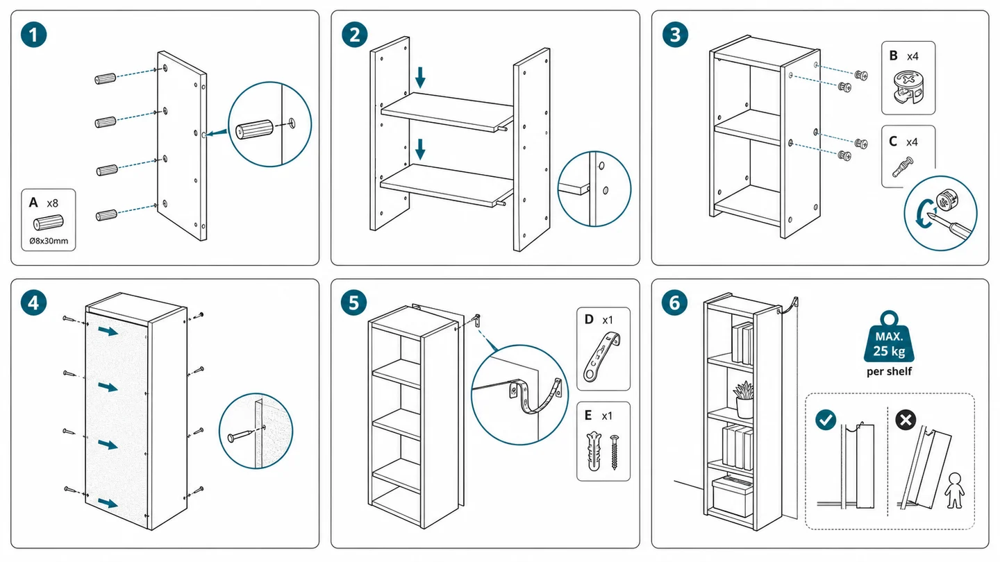
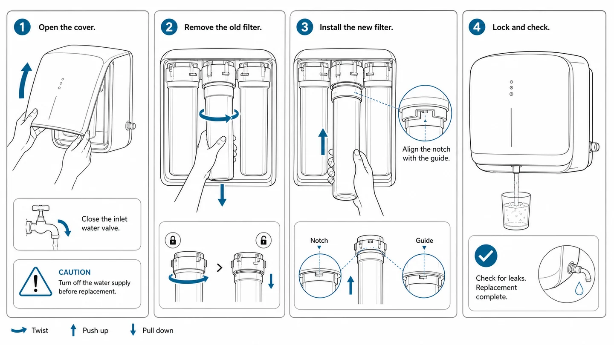
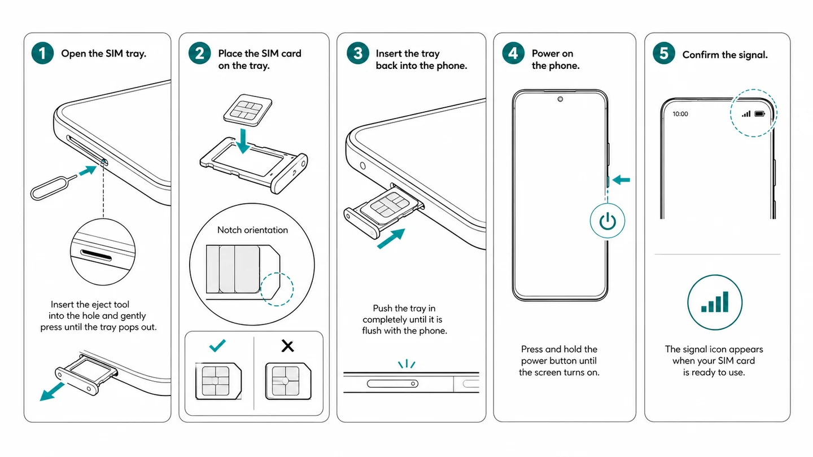
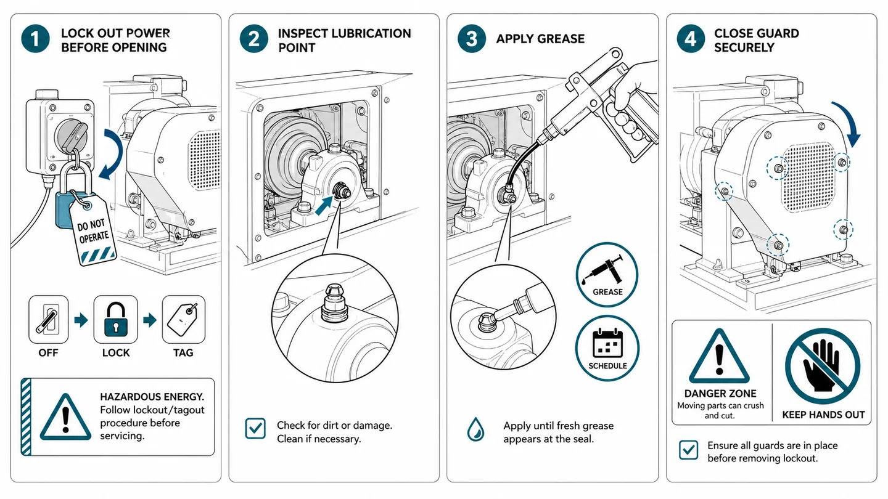
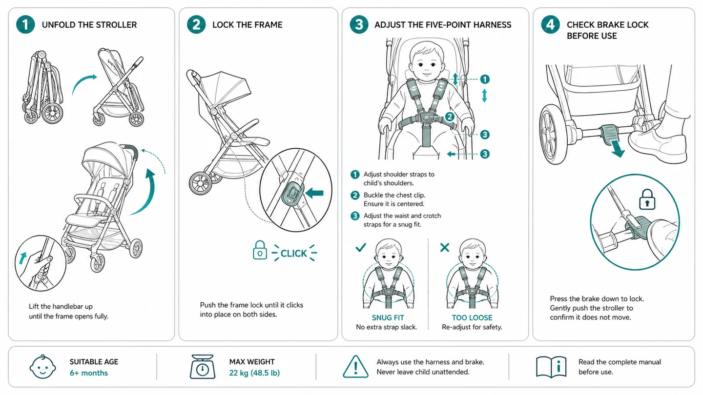
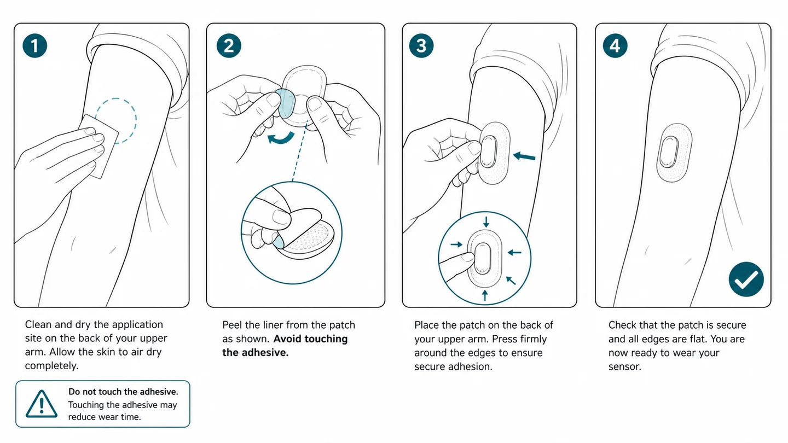

# Annotated Instruction Illustration Examples / 说明书插图成品示例解析

This directory contains **6 finished product manual and instruction illustrations** across furniture assembly, home appliance maintenance, consumer electronics quick-start guides, industrial equipment maintenance, juvenile product safety checks, and wearable medical device IFUs.

本目录收录了 **6 张跨行业成品说明书插图示例**，涵盖家具组装、家电维护、消费电子快速入门、工业设备维护、儿童推车安全检查与可穿戴医疗器械使用说明（IFU），并逐一对照 [`guide/en.md`](../guide/en.md) 与 [`guide/zh-CN.md`](../guide/zh-CN.md) 解析每张图所体现的规范做法。

---

## Quick Index / 示例速览

| File / 文件 | Category / 场景 | Demonstrated Guidelines / 对应规范章节 |
|-------------|----------------|--------------------------------------|
| [`result-furniture-assembly.webp`](./result-furniture-assembly.webp) | Furniture Assembly · 家具装配 | §1, §2, §3, §5, §6, §7 |
| [`result-appliance-filter.webp`](./result-appliance-filter.webp) | Appliance Maintenance · 家电维护 | §1, §2, §4, §7 |
| [`result-electronics-sim.webp`](./result-electronics-sim.webp) | Electronics Quick Start · 消费电子快速入门 | §1, §2, §3, §4, §6 |
| [`result-industrial-maintenance.webp`](./result-industrial-maintenance.webp) | Industrial Maintenance · 工业设备维护 | §1, §2, §3, §4, §7 |
| [`result-stroller-safety.webp`](./result-stroller-safety.webp) | Stroller Setup & Safety · 儿童推车安全设置 | §1, §2, §4, §5, §7 |
| [`result-medical-ifu.webp`](./result-medical-ifu.webp) | Medical Device IFU · 医疗器械 IFU | §1, §2, §3, §7, §8 |

---

## 1. Bookshelf Assembly & Anti-Tip Strap · 书架装配与防倾倒固定

- **Description (EN)**: Furniture assembly — bookshelf assembly and anti-tip strap: an exploded assembly sequence with screws, wooden dowels, cam locks, magnified detail circles, and a shelf load / anti-tip warning.
- **画面说明（中文）**：家具装配——书架装配与防倾倒固定：包含爆炸装配顺序、螺丝和木榫标注、偏心轮细节放大圈以及单层承重与防倾倒警示。
- **Practices Demonstrated / 体现的规范做法**：
  - **§1 One Action per Step / 一步一个动作**：6 个编号面板分别独立表达插木榫、拼隔板、锁偏心轮、钉背板、装防倾倒墙固带与最终检查，同类对称紧固件（如 `A ×8`）合并在单步内，异类动作严格分开。
  - **§2 Isometric Continuity + Exploded Axes + Detail Circles / 等轴测连贯机位 + 爆炸轴线 + 局部放大**：全程保持稳定的等轴测观察角，细虚线标示同轴插接路径，并用局部放大圈展示木榫入孔、偏心轮十字螺丝刀旋转及防倾倒带墙面固定细节。
  - **§5 Hardware Callout Boxes / 步骤内零件框**：第 1、3、5 步均在面板内列出本步耗用的五金件代号、外形与数量（`A x8 Ø8x30mm`、`B x4`、`C x4`、`D x1`、`E x1`）。
  - **§6 Wordless Design / 无文字图解**：全图无需长句说明即可传达零件规格、方向与安装顺序，适合多国共版印刷。
  - **§7 Point-of-Risk Load & Tipping Comparison / 就近承重与正误对比**：在第 6 步直接标出单层承重上限（`MAX. 25 kg per shelf`），并用侧面正交图并排对比已固定墙带（`✓`）与未固定倾倒风险（`✗`）。

---

## 2. Water Purifier Filter Replacement · 净水器滤芯更换

- **Description (EN)**: Appliance maintenance — water purifier filter replacement: covers front cover opening, inlet valve shut-off caution, old filter twist-out motion, notch-and-guide alignment callout, locking step, and final leak check.
- **画面说明（中文）**：家电维护——净水器滤芯更换：覆盖关水提示与开盖、旋出旧滤芯、缺口对位安装新滤芯、锁定和最终漏水检查。
- **Practices Demonstrated / 体现的规范做法**：
  - **§1 Pre-Action Prerequisite & Completion Check / 前置条件与完成检查**：4 个面板依次覆盖“关水并开盖 → 旋出旧滤芯 → 对位推入新滤芯 → 锁定并检查漏水”，首尾闭环完整。
  - **§2 Detail Magnifiers for Micro-Alignment / 微小对位特征局部放大**：第 3 步使用双放大圈清晰标出滤芯接口的凹槽（`Notch`）与机身导轨（`Guide`）对齐关系；第 4 步放大出水接头提示检查渗漏。
  - **§4 Distinct Motion Arrows & Page Legend / 动作箭头区分与页脚图例**：用立体环绕弧形箭头表达旋转（`Twist`），直箭头表达上推（`Push up`）与下拉（`Pull down`），配合挂锁闭合/开启图标（`🔒 > 🔓`）及左下方统一箭头图例，消除方向歧义。
  - **§7 Proximity Caution Block / 风险就近提示**：更换滤芯前关闭水源的注意提示（`CAUTION: Turn off the water supply before replacement`）直接画在第 1 步面板内，避免用户先拔滤芯导致喷水。

---

## 3. Electronics SIM Card Quick Start · 消费电子 SIM 卡安装快速入门

- **Description (EN)**: Consumer electronics quick-start user guide for SIM card installation: clean line-art panels showing tray ejection, SIM card notch orientation with correct/incorrect states, flush tray insertion, power-on, and signal confirmation.
- **画面说明（中文）**：消费电子 SIM 卡安装快速入门线稿：用 5 个步骤面板说明取卡托、核对缺口方向与正确/错误状态对比、推入卡托至齐平、开机及检查信号状态。
- **Practices Demonstrated / 体现的规范做法**：
  - **§1 Sequential Quick-Start Flow / 快速入门分步拆解**：按首次使用顺序拆分为弹出卡托、放置卡片、推回卡托、长按开机、确认信号 5 个单一动作面板。
  - **§2 Task-Matched Viewpoints / 按任务切换最优视角**：取装卡托采用局部等轴测视图展现插拔空间方向；核对斜角防呆缺口（`Notch orientation`）、检查卡托侧面齐平度及查看屏幕信号栏则切换为无透视变形的平面正交视图。
  - **§3 Single-Accent Monochrome Hierarchy / 单强调色线稿层级**：机身与卡托保持干净黑白线稿，仅用单一深青强调色突出步骤圆标、取卡针推入箭头、开机键位置与完成态信号图标。
  - **§6 & §7 Orientation Poka-Yoke (`✓` / `✗`) / 防呆朝向正误对比**：针对用户最易放反的斜切角方向，在第 2 步底部并排给出 `✓` 与 `✗` 对照框，并在第 3 步底部画出卡托与边框齐平的完成态。

---

## 4. Industrial Equipment Maintenance & Lockout · 工业设备维护与上锁挂牌

- **Description (EN)**: Technical maintenance illustration for industrial equipment: a four-step maintenance and safety diagram covering power lockout/tagout before opening, lubrication point inspection, grease application, and guard re-installation with final safety checks.
- **画面说明（中文）**：工业设备维护技术插图：展示开盖前断电上锁挂牌（Lockout/Tagout）、检查润滑点、注油操作以及合上防护罩与最终安全检查的四步作业流程。
- **Practices Demonstrated / 体现的规范做法**：
  - **§1 Safety-Gated Step Sequence / 安全前置步骤编排**：将“断电并上锁挂牌”独立设为第 1 步（附 `OFF → LOCK → TAG` 流程子图标），而不是作为注油步骤的文字附注。
  - **§2 Wedge-Connected Detail Callouts / 锥形引线局部放大**：第 2、3 步通过锥形指示角引出圆形放大视图，把深藏在轴承座上的细小黄油嘴与油脂挤出状态放大至清晰可读尺寸。
  - **§3 Foreground vs. Context Stroke Hierarchy / 前景与背景设备线宽分层**：当前操作的开关盒、挂锁、注油枪与防护罩采用较粗实线，后方电机与底座采用浅细辅线，复杂工业结构依然主次分明。
  - **§7 Point-of-Risk Hazard & Prohibition Cues / 风险点警示与禁止标识**：第 1 步配危险能量警告框（`HAZARDOUS ENERGY`），第 4 步用虚线圈标出 4 颗护罩紧固螺钉，并并列危险区三角标与禁止伸手圆环图标（`KEEP HANDS OUT`），强调护罩锁紧前不得解除挂锁。

---

## 5. Stroller Setup, Harness Fit & Brake Check · 儿童推车展开、安全带与刹车检查

- **Description (EN)**: User manual safety illustration for stroller setup and harness check: four-panel guide covering unfolding the stroller, locking the frame latch, adjusting the five-point harness with snug-vs-loose comparison, and checking the foot brake lock before use.
- **画面说明（中文）**：儿童推车安全设置和安全带检查用户手册插图：用图说明展开车架、锁定车架卡扣、调节五点式安全带（含贴合与过松正误对比）以及使用前踩下刹车锁并确认稳固。
- **Practices Demonstrated / 体现的规范做法**：
  - **§2 & §4 Arc Motion + `CLICK` Lock Confirmation / 弧形展开轨迹与锁定反馈**：第 1 步用大弧线箭头配合折叠态到展开态演进；第 2、4 步在局部放大圈旁配闭合挂锁图标与 `CLICK` 放射提示线，明确传达“推到底并听到锁定声”的判断标准。
  - **§5 Sub-Numbered Adjustment Callouts / 局部多点调节子编号**：第 3 步针对五点式安全带的肩带高度、胸扣居中、腰胯带收紧分别标出 `1`、`2`、`3` 调节位，条理清晰。
  - **§7 "Almost Right" Safety Comparison (`✓` vs. `✗`) / “差一点就对”的安全对比**：儿童安全带扣上但留有松弛空隙是典型隐患，第 3 步下方直接放大对比 `✓ SNUG FIT`（贴合无冗余）与 `✗ TOO LOOSE`（肩带悬空过松），并在页面底部汇总适用月龄、最大承重（`22 kg / 48.5 lb`）与使用前通读手册提示。

---

## 6. Wearable Sensor Patch IFU · 可穿戴传感器贴片使用说明（IFU）

- **Description (EN)**: Medical device IFU illustration for wearable sensor patch application: numbered panels showing upper-arm site cleaning, adhesive liner peeling with handling caution, firm perimeter placement, and final flat-edge verification.
- **画面说明（中文）**：医疗器械 IFU 图示——可穿戴传感器贴片使用步骤：包含上臂部位清洁干燥、揭除衬纸与粘胶禁触警告、按压贴附边缘局部放大以及最终贴合确认。
- **Practices Demonstrated / 体现的规范做法**：
  - **§1 & §2 Delicate Hand-Action Magnification / 手部精细动作拆解与放大**：第 1 步用虚线圈标定上臂背面清洁区域；第 2 步放大手指捏住衬纸翻边的角度，避免误触胶面；第 3 步放大展示沿贴片四周向内按压边缘的动作箭头。
  - **§3 Calm Uncluttered Line Art / 克制无噪点线稿**：省去皮肤阴影与多余衣纹，仅用简洁轮廓线突出擦拭片、衬纸分层与贴片边缘，黑白打印依然清晰。
  - **§7 & §8 Clean Artwork + Externalized Captions / 图文分离与就近注意框**：步骤面板内部无内嵌长句文字，所有说明段落与左下角禁触粘胶提示框（`Do not touch the adhesive`）均独立排布在面板下方，便于多语种本地化替换并留有充足行距余量。
